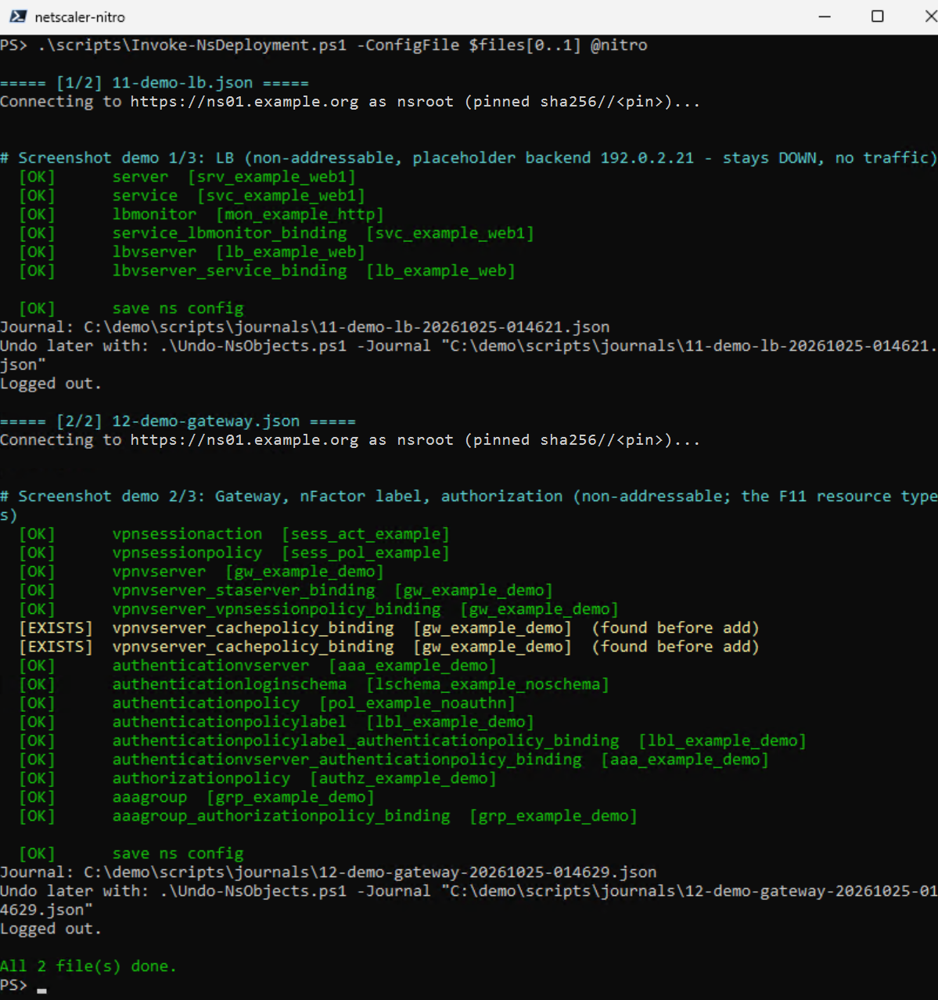
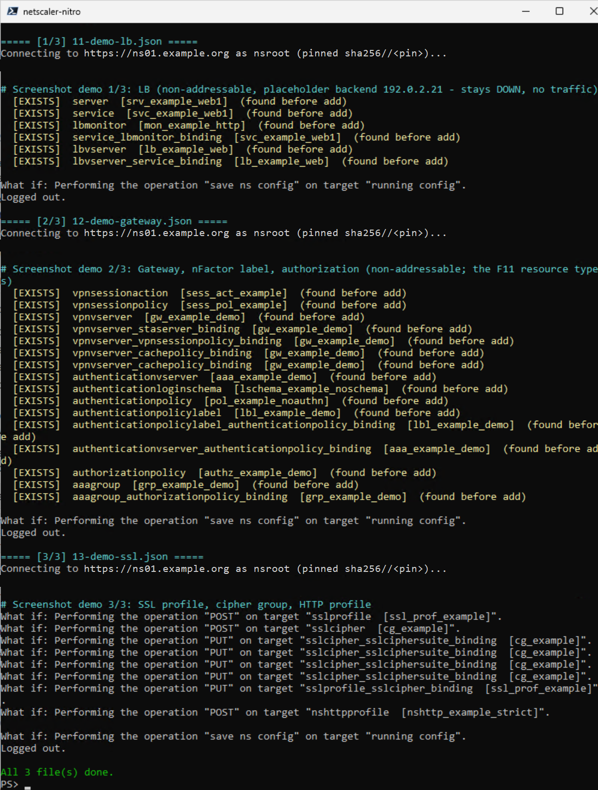
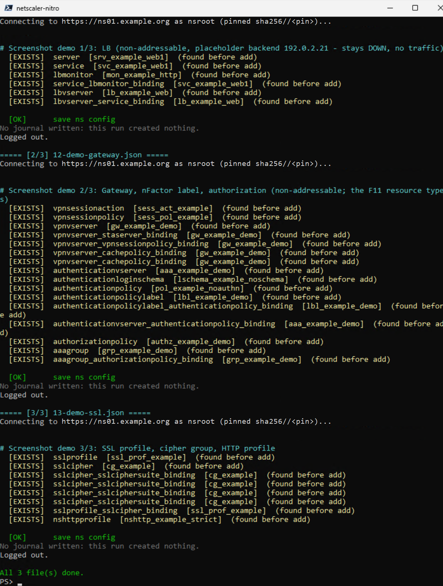
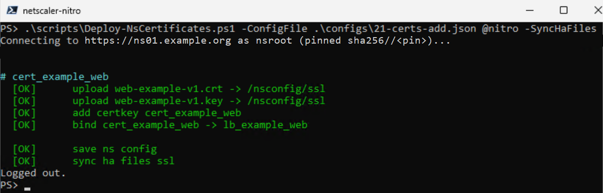
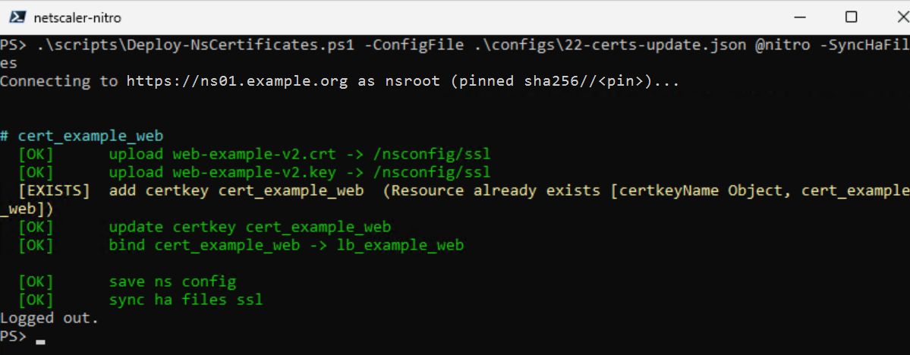
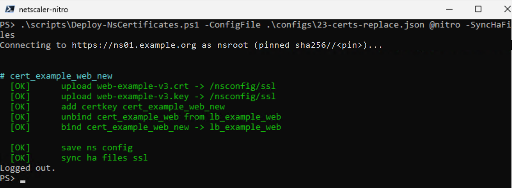
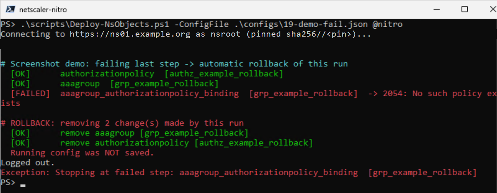
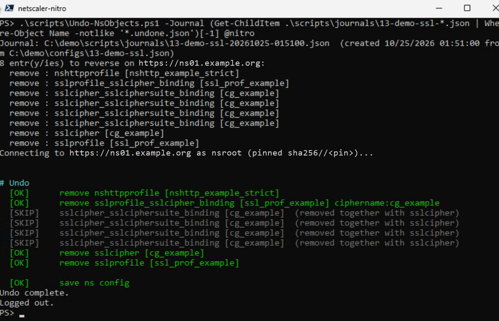
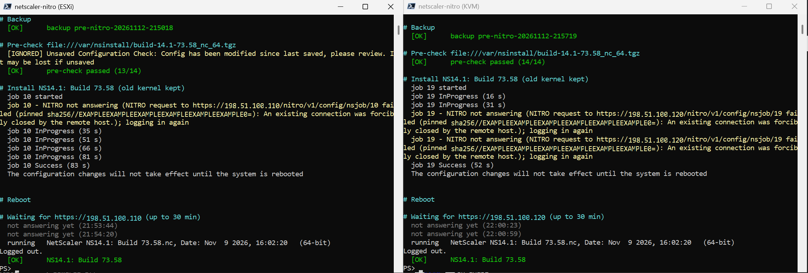
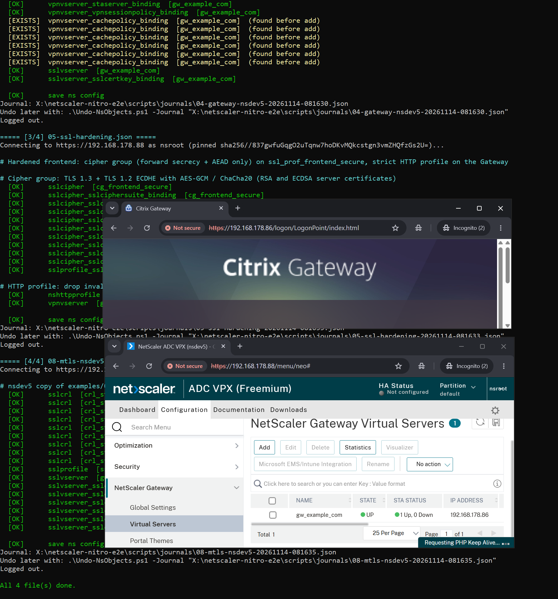

# netscaler-nitro

PowerShell 7 toolset that deploys NetScaler (ADC / Gateway) configuration through the **NITRO REST API** from JSON files, instead of typing CLI commands over SSH.

- **Declarative JSON configs**: one file per area (certificates, LB, AAA, Gateway, ...)
- **Certificates**: upload, create, link to CA, bind, in-place renewal, swap on vservers with rollback
- **Objects**: any NITRO resource, safe to re-run (every add/bind is looked up first; existing objects are skipped and never journaled)
- **Safety**: dry run (`-WhatIf`), automatic rollback on failure, journal + undo, optional `-NoSave` and `-Backup`
- **Runs on Windows and Linux** (PowerShell 7), no extra modules required

Tested against NetScaler **14.1** (lab and a production migration).

## Screenshots

Real runs against a NetScaler 14.1 lab VPX (HA pair) with throwaway `*_example_*` objects; host name and management
key pin are redacted (except the end-to-end run on a throwaway lab VPX).

<details>
<summary><b>One flow</b>: deploy two files, journal + undo hint per file</summary>

`.\scripts\Invoke-NsDeployment.ps1 -ConfigFile $files[0..1] @nitro`. The two `[EXISTS]` are cache policies that
NetScaler binds to every new VPN and authentication (AAA) vserver by itself: found by the lookup, so they stay out of the journal.


</details>

<details>
<summary><b>Dry run</b> (<code>-WhatIf</code>): what exists, what would be created</summary>

Files 11 and 12 are already deployed (`[EXISTS] (found before add)`), only file 13 shows `What if`. Nothing is changed.


</details>

<details>
<summary><b>Re-run</b>: every step found, nothing journaled</summary>

Safe to re-run: every add/bind is looked up first, and a run that created nothing writes no journal.


</details>

<details>
<summary><b>Certificates</b>: add, renew in place, replace</summary>

Upload + add certkey + bind:



Renewal in place (`"update": true`): same certkey, new files, binding kept:



Replace (`"replace": true`): new certkey, old one unbound, new one bound:


</details>

<details>
<summary><b>Rollback</b>: a failing step removes what this run created</summary>


</details>

<details>
<summary><b>Undo</b> from a journal</summary>

Reverse order; bindings that go away with their parent object are skipped, a binding that blocks the removal of
another object (SSL profile cipher group) is removed first.


</details>

<details>
<summary><b>Firmware upgrade</b>: two standalone VPX in parallel, ESXi and KVM</summary>

`.\scripts\Update-NsFirmware.ps1 @fw`, one PowerShell window per node, 14.1-73.49 -> 73.58. The installer restarts
the web services while it copies files; the script logs in again and follows the job to the end, then reboots and
waits for the new build. Left: the "unsaved config" flag every node sets at boot, ignored with `-IgnoreUnsavedConfig`.
Addresses and pins replaced with placeholders. See [docs/firmware-upgrade.md](docs/firmware-upgrade.md).


</details>

<details>
<summary><b>End to end</b>: empty ESXi host to a working Gateway from one site file</summary>

`.\scripts\Deploy-NsSite.ps1 -SiteFile <site file>`: new VPX, base, certificates, then the object files
(Gateway, SSL hardening, mTLS with three client CA chains). Front: the Gateway logon page on the new VIP and the
Gateway vserver UP in the GUI of the new VPX. Unredacted: a throwaway lab VPX with its private lab addresses, VM
name and management key pin. See [docs/end-to-end.md](docs/end-to-end.md).


</details>

## Repository layout

```
netscaler-nitro/
├── scripts/
│   ├── NetScalerNitro.psm1        shared module (login, NITRO calls, results, rollback helpers)
│   ├── Deploy-NsCertificates.ps1  certificate deployment
│   ├── Deploy-NsObjects.ps1       configuration objects (with rollback + journal)
│   ├── Undo-NsObjects.ps1         removes a previous deployment using its journal
│   ├── Invoke-NsDeployment.ps1    runs several object files in order (one-flow), prompts secrets once
│   ├── Update-NsFirmware.ps1      firmware upgrade of one node: upload, pre-check, install, reboot, verify
│   ├── Invoke-NsLasLicense.ps1    offline LAS licensing: status of many appliances, request, activation
│   └── Deploy-NsSite.ps1          end to end from one site file: new VPX -> base -> certificates -> objects
├── templates/                     all supported patterns, every step disabled ("skip": true)
│   ├── certs-template.json
│   └── objects-template.json
├── examples/                      a complete, generic StoreFront + SAML or Entra OIDC Gateway setup
│   ├── 00-prereq.json             host name, DNS, NTP, default SSL profile, least-privilege certificate user
│   ├── 00-network.json            optional static routes / VLAN / SNIP (all steps skip:true)
│   ├── 01-certs-example.json
│   ├── 01-certs-client-ca.json    optional client CA chains + first CRL copies for 08
│   ├── 02-lb-storefront.json
│   ├── 03-aaa-saml.json           SAML IdP ...
│   ├── 03-aaa-oidc-entra.json     ... or Microsoft Entra ID via OIDC (same AAA/profile names)
│   ├── 04-gateway.json
│   ├── 05-ssl-hardening.json      cipher group (forward secrecy + AEAD only), strict HTTP profile with WebSocket
│   ├── 06-callback.json           optional dedicated StoreFront callback vserver
│   ├── 07-authorization.json      optional authorization policies via AAA group (clientless / RDP proxy)
│   ├── 08-mtls-client-ca.json     optional client certificates on the Gateway: several CA chains, CRL Mandatory
│   ├── 09-netscaler-monitoring.json  optional: remote syslog + one audit line per Gateway logon with a client cert
│   └── site.example.json          site file for Deploy-NsSite.ps1 (VPX parameters + the files above in order)
├── tests/
│   ├── Test-NsObjects.ps1         offline test against a fake NITRO API (dry run, journal, re-run, undo)
│   ├── Test-NsFirmware.ps1        offline test of the firmware upgrade flow
│   ├── Test-NsLasLicense.ps1      offline test of the LAS status / request / activation flow
│   └── Test-NsSite.ps1            offline test of the end-to-end site deploy (fake NITRO over TLS, VPX stub)
├── configs/                       your real environment configs - ignored by git (no secrets in here!)
├── certs/                         certificate/key files - ignored by git
└── docs/
    ├── getting-started.md
    ├── config-reference.md
    ├── certificates.md
    ├── rollback-and-undo.md
    ├── linux.md
    ├── firmware-upgrade.md
    ├── las-licensing.md
    ├── troubleshooting.md
    └── end-to-end.md
```

The files in `scripts/` must stay together: every script loads `NetScalerNitro.psm1` from its own folder.

## Quick start

```powershell
# 1. dry run - logs in, shows what would happen, changes nothing
./scripts/Deploy-NsCertificates.ps1 -ConfigFile ./examples/01-certs-example.json -SkipCertificateCheck -WhatIf

# 2. certificates first, then objects in order
./scripts/Deploy-NsCertificates.ps1 -ConfigFile ./examples/01-certs-example.json -SkipCertificateCheck
./scripts/Deploy-NsObjects.ps1      -ConfigFile ./examples/02-lb-storefront.json -SkipCertificateCheck
./scripts/Deploy-NsObjects.ps1      -ConfigFile ./examples/03-aaa-saml.json      -SkipCertificateCheck
./scripts/Deploy-NsObjects.ps1      -ConfigFile ./examples/04-gateway.json       -SkipCertificateCheck

# 3. remove a deployment again (reverse order)
./scripts/Undo-NsObjects.ps1 -Journal ./scripts/journals/04-gateway-<timestamp>.json -SkipCertificateCheck
```

See [docs/getting-started.md](docs/getting-started.md) for requirements, credentials and the full workflow.

No VPX yet? `scripts/Deploy-NsSite.ps1` goes from an empty ESXi host to a working Gateway in one run, together with
netscaler-vpx-deploy: [docs/end-to-end.md](docs/end-to-end.md).

## Common switches

| Switch | Scripts | Effect |
|---|---|---|
| `-WhatIf` | all | Dry run: shows planned changes, changes nothing |
| `-Credential` | all | Login credential; prompted for if omitted |
| `-SkipCertificateCheck` | all | Accept the NetScaler's self-signed management certificate (no check at all) |
| `-PinnedPublicKey` | all | Accept only this management certificate key (`sha256//...`), checked on every request |
| `-NoProxy` | all | Connect directly, bypassing the system/corporate proxy |
| `-NoSave` | all | Don't run `save ns config` (a reboot reverts the changes) |
| `-Backup` | deploy scripts | Create a system backup before changing anything |
| `-ContinueOnError` | deploy scripts | Keep going after a failed step |
| `-NoRollback` | `Deploy-NsObjects` | Keep partial changes after a failure (for troubleshooting) |
| `-SyncHaFiles` | `Deploy-NsCertificates` | `sync ha files ssl` after uploading certificates |

## Tests

```powershell
./tests/Test-NsObjects.ps1    # no NetScaler needed: fake NITRO API on 127.0.0.1
./tests/Test-NsFirmware.ps1   # firmware upgrade flow against a fake NITRO API
./tests/Test-NsLasLicense.ps1 # LAS licensing (status of several appliances, request, activation)
./tests/Test-NsSite.ps1       # end-to-end site deploy: phases, pin on first contact, -From / -SkipVpx, CRL upload
```

## Related

- [netscaler-vpx-deploy](https://github.com/bensplittgerber/netscaler-vpx-deploy): unattended NetScaler VPX
  deployment on VMware ESXi (OVF, first-boot network config, nsroot change) - the Vpx phase of `Deploy-NsSite.ps1`.
- [netscaler-rdp-proxy-oidc](https://github.com/bensplittgerber/netscaler-rdp-proxy-oidc): complete RDP proxy Gateway
  with Microsoft Entra ID (OIDC) and authorization through an AAA group, deployed with these scripts.

## Documentation

- [Getting started](docs/getting-started.md)
- [Config file reference](docs/config-reference.md)
- [Certificates](docs/certificates.md)
- [Rollback and undo](docs/rollback-and-undo.md)
- [Firmware upgrade](docs/firmware-upgrade.md)
- [Offline LAS licensing](docs/las-licensing.md)
- [Running on Linux](docs/linux.md)
- [Troubleshooting](docs/troubleshooting.md)
- [End to end: empty ESXi host to a working Gateway](docs/end-to-end.md)
- [Certificate usage monitoring (optional)](docs/monitoring.md)
- [Changelog](CHANGELOG.md)

## Security notes

- Never commit certificates, keys, `.cred.xml` files or passwords. `.gitignore` covers the usual cases; secrets in configs go through `${env:NAME}` placeholders.
- Use a dedicated NetScaler account instead of `nsroot` for routine runs.
- `-SkipCertificateCheck` sends the credentials to whoever answers on the NSIP. Prefer `-PinnedPublicKey` (works with the self-signed certificate) or a trusted management certificate. Get the pin with `Get-NitroPin` or `acme-ns pin` and compare it out of band once.
- Keep management traffic off web proxies (`-NoProxy` or a proxy exception), so credentials never pass an inspecting proxy.

## License

[MIT](LICENSE)
