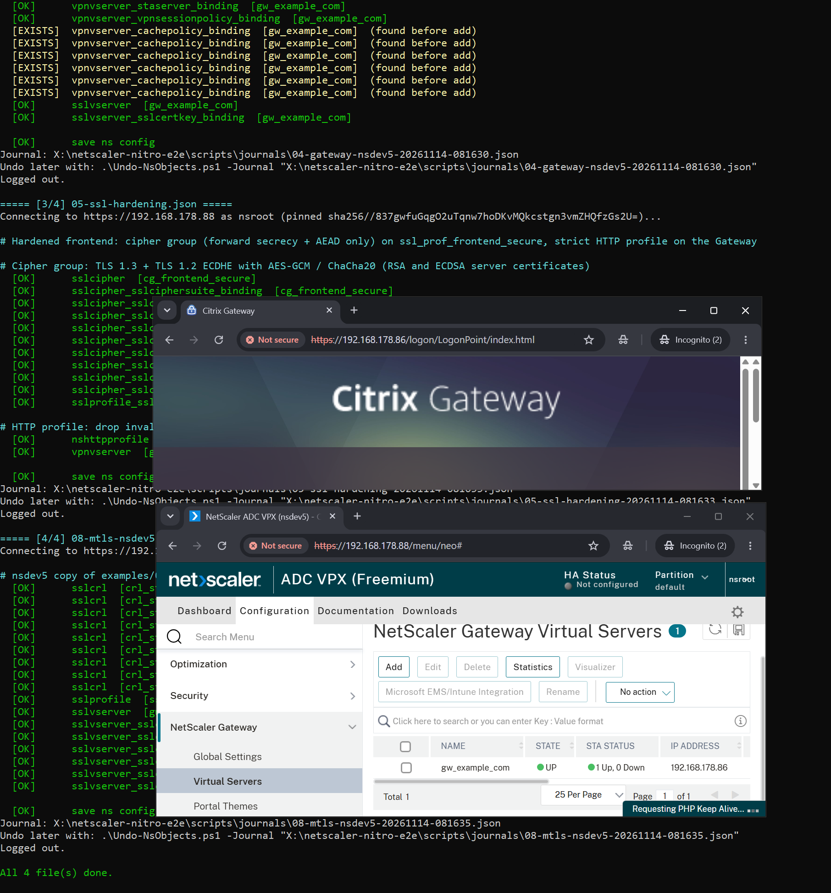

# End to end: empty ESXi host to a working Gateway

`scripts/Deploy-NsSite.ps1` runs the whole chain from one **site file**:

```
Vpx           netscaler-vpx-deploy: OVF import, first-boot network config, nsroot change, CallHome/MBF off
  -> Base         00-network (optional), 00-prereq: host name, DNS, NTP, default SSL profile, certificate user
  -> Certificates  files (Deploy-NsCertificates.ps1)  or  netscaler-acme (wait until the certKeys exist)
  -> Objects       02-lb-storefront, 03-aaa-*, 04-gateway, 05-ssl-hardening, ...
```

Each phase uses the existing tools; nothing new happens on the NetScaler that the single scripts would not do.

## Requirements

- Everything in [getting-started.md](getting-started.md), plus for the Vpx phase the requirements of
  **netscaler-vpx-deploy** (Windows, VMware PowerCLI, the VPX OVF on a datastore; see its `docs/vmware.md`).
- netscaler-vpx-deploy cloned next to this repo (the site file points to its script):
  ```
  src/
  ├── netscaler-nitro/
  └── netscaler-vpx-deploy/
  ```
- Your object files: copy `examples/` and adapt names, addresses and backends (see the README of `examples/`).

## Site file

`examples/site.example.json` (paths relative to the site file):

| Key | Meaning |
|---|---|
| `nsip` | management address of the VPX - used for the deploy and every NITRO call; it replaces the `nsip` inside the object and certificate files (`-NsIp`), so the same files work for several appliances. An address (`192.0.2.10`) or a URL with another port (`https://192.0.2.10:8443`) |
| `noProxy` | NITRO and the deploy bypass the system proxy |
| `vpx.script` | path to `netscaler-vpx-deploy/vmware/Deploy-NsVpx.ps1` |
| `vpx.parameters` | parameters of `Deploy-NsVpx.ps1` (`EsxHost`, `OvfPath`, `VmName`, `Datastore`, `Gateway`, `Snip`, `DnsServer`, `NicType`, ...); not `Nsip` (comes from `nsip`) |
| `base` | object files before the certificates (`00-network.json`, `00-prereq.json`) |
| `certificates.mode` | `files`: `Deploy-NsCertificates.ps1` with `certificates.file` (one file or a list, e.g. `01-certs-example.json` + `01-certs-client-ca.json` for the optional mTLS file `08-mtls-client-ca.json`); `acme`: wait for `certificates.certKeys`; `none` |
| `certificates.certKeys`, `acmeConfigs`, `waitMinutes` | `acme` mode: certKey names acme-ns deploys, config names printed as commands, how long to wait (default 60) |
| `objects` | object files after the certificates, in order. Optional files are not listed by default: add `08-mtls-client-ca.json` and/or `09-netscaler-monitoring.json` at the end when you want them ([monitoring.md](monitoring.md)) |
| `secrets` | environment variables the files use (`${env:NAME}`), prompted masked once |

## Run

```powershell
# dry run: the VPX checks + userdata (ESXi login), and the list of files per phase
./scripts/Deploy-NsSite.ps1 -SiteFile ./configs/site-a.json -WhatIf

# the real run
./scripts/Deploy-NsSite.ps1 -SiteFile ./configs/site-a.json

# existing VPX (no Vpx phase), resume at the objects after a fix
./scripts/Deploy-NsSite.ps1 -SiteFile ./configs/site-a.json -SkipVpx -From Objects -PinnedPublicKey 'sha256//...'
```

Prompts, all before the first change: the nsroot login for the NITRO phases (the **new** password when the VPX is
deployed in the same run) and the `secrets`. `Deploy-NsVpx.ps1` then asks for its own passwords (ESXi login, the
image's default nsroot password, the new one twice). Secrets are removed from the environment at the end; nothing
is written to disk. A secret that is already set in the environment is used as it is and not prompted. For an
unattended run pass the nsroot login with `-Credential` (a wrong password then stops the run instead of asking
again).

End of a real run on a lab ESXi host (new throwaway VPX, 14.1-73.58, private lab addresses): the last object
files with their journals, the Gateway logon page on the new VIP and the Gateway vserver UP.



## Trust

After the Vpx phase the self-signed management key is read and pinned (same trust-on-first-use as the deploy, a few
minutes later on the same path) and used for every NITRO call of the run; the pin is printed at the end. Against an
existing VPX pass `-PinnedPublicKey`, or nothing if its management certificate is CA-signed and trusted. Replace the
self-signed certificate afterwards, e.g. with netscaler-acme, and trust the CA instead of a pin.

## Certificates with netscaler-acme

`"mode": "acme"`: after the base phase the script prints the `acme-ns run` commands for the Docker host (first
deployment from `conf/pending/` with the pin override) and checks every 30 seconds until all `certKeys` exist on the
NetScaler, then continues with the objects. Ctrl+C stops the wait; continue later with `-SkipVpx -From Objects`.

## Adapt before the first run

- **SNIP**: backends (StoreFront, IdP, STA) are reached from a SNIP - `vpx.parameters.Snip` (or `00-network.json`).
  Without one the StoreFront monitor fails and the LB vserver stays DOWN (VIP answers ping, 443 closed).
- **StoreFront store path**: the examples use the store `Store` (`/Citrix/StoreWeb/`) in the monitor of
  `02-lb-storefront.json` and in `wihome` of `04-gateway.json`. Another store name (e.g. `/Citrix/DEVWeb/`) has to be
  changed in both places, otherwise the monitor gets 404 and the LB vserver stays DOWN.
- **Features**: `00-prereq.json` enables LB, SSL, SSLVPN, AAA, REWRITE, RESPONDER - a fresh VPX has all of them off.

## After the run

- **Cipher hardening** (`05-ssl-hardening.json`): binding the cipher group adds it next to `DEFAULT`; until `DEFAULT`
  is removed, TLS 1.2 without forward secrecy (e.g. `AES128-SHA`) is still accepted. Remove it once by hand (object
  files cannot unbind): `unbind ssl profile ssl_prof_frontend_secure -cipherName DEFAULT`, `save ns config`.
- Management certificate: see Trust above.

## Failures

Each phase stops at the first failing file; that file rolls itself back (journal, see
[rollback-and-undo.md](rollback-and-undo.md)), earlier files stay. Fix the file and resume with `-From` - earlier
phases are not repeated. A failed Vpx phase keeps the userdata ISO for diagnosis (netscaler-vpx-deploy prints the
`-Cleanup` command).
